<!-- Cards generated by scripts/render_cards.py · refreshed daily by .github/workflows/refresh.yml -->

 
 
 
 
<picture><source media="(prefers-color-scheme: dark)" srcset="./cards/title-dark.svg" /></picture> 

<a href="https://bsvr.work">bsvr.work</a> &nbsp;/&nbsp; <a href="https://github.com/SVR1339">github</a> &nbsp;/&nbsp; <a href="https://hirepat.com">hirepat.com</a>

